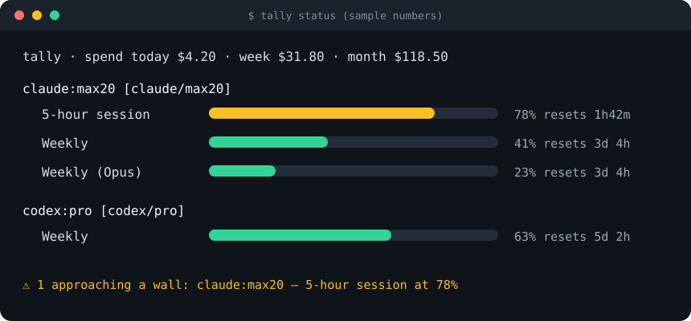

<p align="center"></p>

<p align="center">
  <a href="https://github.com/AkuchiS/tally/actions/workflows/ci.yml"></a>
  
  
  
</p>

**See how close you are to your AI limits — and what you've spent — before you hit the wall.**
Everything is read from files your tools already keep on your own computer. Nothing is uploaded.

<p align="center"></p>

# tally

You run four AI subscriptions and a couple of API keys. You have no idea how close you are
to Claude's 5-hour wall, Cursor's monthly cap, or a $200 API month until it's too late.
`tally` reads the usage your tools already write to disk, counts spend and subscription
windows across every provider, and warns you at **75 / 90 / 100%** before a rate wall stops
you — from your terminal or a local web page.

- **Local-first & private.** No cloud account, no data upload. Everything lives in one
  SQLite file under `~/.tally`. Your prompts never leave your machine — tally only ever
  sees counts, models, and timestamps.
- **Zero-config to start.** `tally sync` reads what's already on disk (Claude Code and Codex
  sessions; more tools as readers land). No API keys required for that.
- **No keys needed.** tally never asks for an API key or a login.
- **$0.** Pure Python standard library — no dependencies, no build step, runs on macOS,
  Linux, and Windows.

It's the self-hosted answer to the AI-usage SaaS trackers: same job (limits + spend +
before-the-wall alerts), but open-source, offline, and free.

## Install

```bash
pipx install "git+https://github.com/AkuchiS/tally"
# or, from a clone:
pip install .
```

Needs Python 3.10+ and nothing else.

## Use

```bash
tally sync                       # read local tool logs into the ledger
tally track claude max20         # track a subscription's limit windows
tally track codex pro            # Codex reports its own used % — shown automatically
tally track cursor pro
tally status                     # gauges: used %, reset countdown, spend, alerts
tally serve                      # open the local web dashboard (127.0.0.1:8848)
tally watch                      # live-updating terminal view
```

### For other tools (JSON)

```bash
tally status --json              # print everything as JSON
tally status --out status.json   # or write it to a file for a dashboard to read
```

The JSON has `spend` (today / week / month / forecast), `accounts` (each with its limit
`windows`: `used_percent`, `reset_at`, `state`), `models_7d`, `heatmap`, and `unpriced`
(models tally has no price for yet). Times are Unix seconds.

Record a call by hand, import a usage file, set a cap, or store a provider read:

```bash
tally add openai gpt-5 --in 12000 --out 3000      # a manual/BYOK-logged call
tally import usage.jsonl                           # {ts,model,in_tokens,out_tokens,...}
tally cap cursor:pro month 500                     # enable the % bar for a known cap
tally snapshot claude:max20 5h 82                  # a provider-supplied used% read
```

## What it reads

| Tool | Where | What tally takes |
|---|---|---|
| Claude Code | `~/.claude/projects/**/*.jsonl` | token counts and model per reply (de-duplicated by message id) |
| Codex | `~/.codex/sessions/**/*.jsonl` | token counts and model per turn, plus the latest used-% and reset time |
| Anything else | a JSONL file you point `tally import` at | `{ts, model, in_tokens, out_tokens, ...}` |

Only numbers, model names and timestamps are stored. Prompts and replies are never read into
the ledger.

Good to know:

- **Spend is an estimate.** Dollar figures are list-price API equivalents, so on a flat
  subscription they show the *value* you are getting, not what you were billed.
- **Claude's percentage bars need a cap.** Claude does not write its used-% to disk, so tally counts
  requests and shows a bar once you set a cap (`tally cap claude:max20 5h 900`) or paste a
  reading (`tally snapshot claude:max20 5h 82`).
- **Prices** live in [`tally/pricing.py`](tally/pricing.py) with their source and check date. Models
  with no price (some newer Codex models) are listed under `unpriced` and cost $0 until added.

## Privacy

Everything stays on your machine. tally makes no network calls, has no account, no telemetry,
and keeps its data in one SQLite file in `~/.tally`. Delete that folder to forget everything.
`tally serve` listens on `127.0.0.1` only.

## How it works

Every AI limit reduces to a **window**: a rolling or fixed period with a cap and a reset
time. tally fills a window two ways — by **counting** your own recorded events against a cap
(works for anything readable locally), or from a **snapshot** a provider hands you
(`used_percent` + `reset_at`). The engine rolls windows + spend into one `status()` that the
CLI, the dashboard, and integrations all read.

```
sources.py   read local tool logs  ─┐
store.py     append-only SQLite ledger ─┼─►  engine.status()  ─►  CLI · dashboard · alerts
limits.py    provider/plan window registry ─┤
pricing.py   per-model price table + cost ─┘
```

## Adding a tool

A reader is a function that yields normalized event dicts (`{ts, provider, model,
in_tokens, out_tokens, cache_read, cache_write, cost_usd, dedup}`) and gets registered in
`sources.READERS`. The `dedup` key makes re-imports idempotent, so a watch loop can re-scan
the same files safely. PRs welcome.

## License

MIT — see [LICENSE](LICENSE). Built by AkuchiS. Not affiliated with any AI provider.

## Develop

```bash
python3 tests/test_tally.py     # offline, standard library only
```
